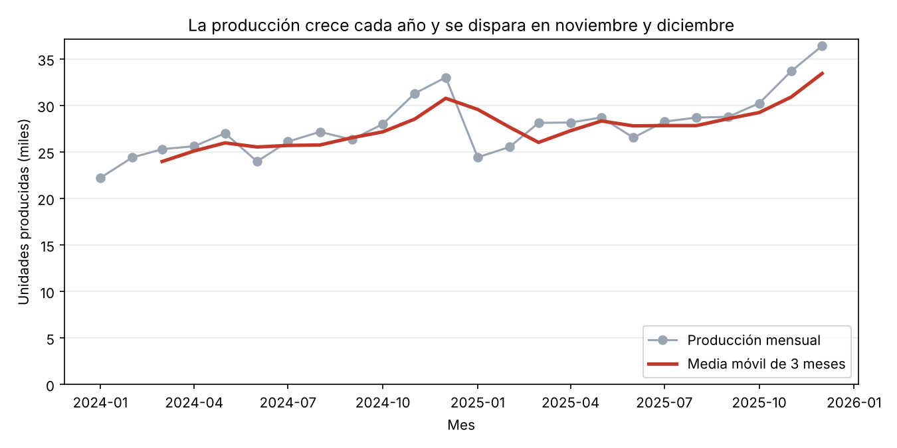
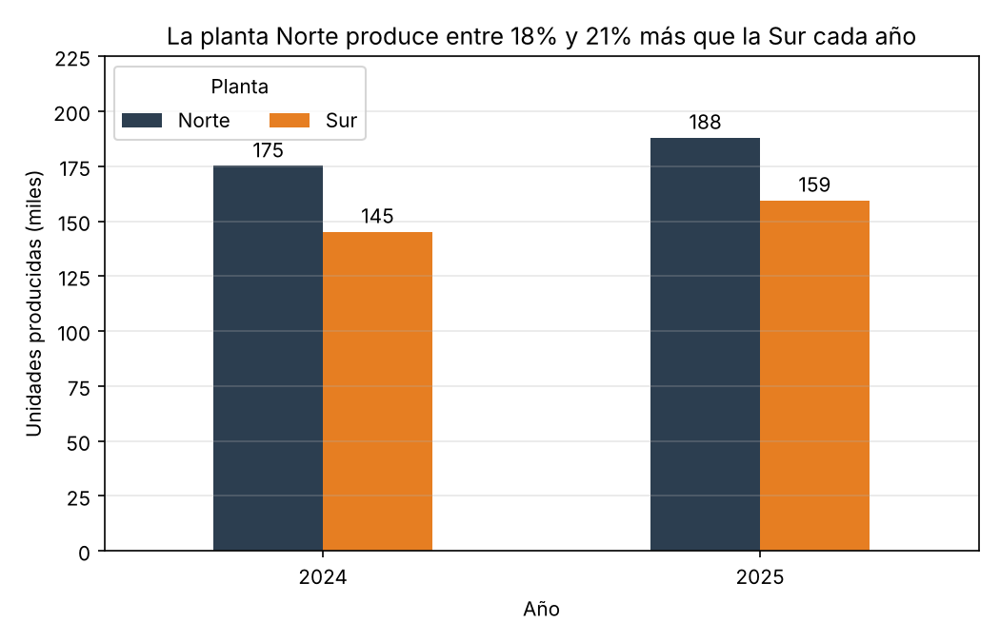

# Actividad calificable Corte 3: Análisis temporal y visualización

**Curso:** Electiva VI, Ciencia de Datos (2026-B)
**Estudiante:** Simón Enrique Zapata Claros

## Datos usados

Serie temporal de **producción diaria en unidades** de dos plantas (Norte y Sur) de una empresa de manufactura, del 1 de enero de 2024 al 31 de diciembre de 2025. Son 1.462 registros con las columnas `fecha`, `planta` y `unidades`, sin valores nulos. Los datos son simulados para el ejercicio y se generan con `generar_datos.py`.

## 1. Serie temporal: resample y media móvil

Código en `analisis.py`:

```python
df = pd.read_csv("produccion.csv", parse_dates=["fecha"])
diario = df.groupby("fecha")["unidades"].sum()      # total de las dos plantas por día
mensual = diario.resample("MS").sum()                # agregado por mes
media_movil_3m = mensual.rolling(3).mean()           # media móvil de 3 meses
media_movil_7d = diario.rolling(7).mean()            # media móvil de 7 días
```

Nota: en la versión de pandas usada (3.0.5) el código `"M"` ya no existe, por eso se usa `"MS"` (mes, con fecha al inicio del mes). El resultado es el mismo que con `resample("M")`.

**Tendencia.** La producción sube de un año a otro: en 2024 se produjeron 320.309 unidades y en 2025 se produjeron 347.431, un **8,5% más**. La media móvil de 3 meses lo confirma: pasa de 23.963 unidades (marzo de 2024, el primer dato disponible) a 33.430 (diciembre de 2025). No sube en línea recta, porque después de cada pico de diciembre baja unos meses (de 30.759 en diciembre de 2024 a 26.018 en marzo de 2025) y luego se recupera.

**Ruido.** Los datos diarios varían mucho de un día a otro, sobre todo por el fin de semana. La media móvil de 7 días y la agregación mensual sirven para quitar ese ruido y ver el patrón de fondo.

**Estacionalidad.** Se repite el mismo patrón en los dos años:
- Noviembre y diciembre producen en promedio un **20,7% más** que el promedio general (32.478 y 34.696 unidades por mes). Por año da 20,4% en 2024 y 21,0% en 2025.
- Enero cae un **16,2%** por debajo del promedio general (23.306 unidades), justo después del pico. Por año da 16,8% en 2024 y 15,7% en 2025.
- Entre semana se producen en promedio 1.047 unidades al día y en fin de semana 578.

## 2. Visualizaciones

**Gráfico de evolución** (`grafico_evolucion.png`): producción mensual y media móvil de 3 meses.



**Gráfico de comparación** (`grafico_comparacion.png`): producción total por planta en cada año.



Criterios aplicados en los dos gráficos:
- El título expresa la conclusión, no solo el tema.
- El eje Y empieza en 0, así las diferencias se ven con su tamaño real.
- Los ejes tienen nombre y unidades (miles de unidades).
- El color se usa para destacar: la media móvil va en rojo sobre una línea gris, y cada planta tiene su propio color.
- Se eligió cada tipo de gráfico según la pregunta: líneas para ver la evolución en el tiempo y barras para comparar categorías.
- El gráfico de barras muestra el valor sobre cada barra.

**Lectura para el negocio (contexto, hallazgo, implicación, acción).** La producción crece cada año y tiene un pico fijo a final de año. Esto implica que la capacidad y el inventario de materia prima se necesitan sobre todo en noviembre y diciembre, y que enero queda con capacidad libre. Se recomienda planear turnos y compras de materiales desde octubre, y aprovechar enero para mantenimiento de las máquinas.

## 3. Optimización de una consulta SQL

Indicador: unidades producidas en 2025 por planta. Código en `optimizacion.py`.

**Antes (lenta):**

```sql
SELECT *
FROM produccion
WHERE YEAR(fecha) = 2025;
```

(En SQLite, que es lo que se usó para probar, la función se escribe `strftime('%Y', fecha) = '2025'`.)

**Después (rápida):**

```sql
CREATE INDEX idx_produccion_fecha ON produccion(fecha);

SELECT planta, SUM(unidades) AS total_unidades
FROM produccion
WHERE fecha >= '2025-01-01' AND fecha < '2026-01-01'
GROUP BY planta;
```

**Qué se mejoró:**
1. Se quitó `SELECT *` y se piden solo las columnas necesarias.
2. Se filtra por un rango de fechas en lugar de aplicar una función sobre la columna `fecha`. Con la función, la base de datos tiene que calcular el año de cada fila y no puede usar el índice.
3. Se creó un índice sobre `fecha`.
4. La agregación se hace dentro de la base de datos, y se devuelven 2 filas en vez de 730.

**Comprobación:** las dos consultas dan el mismo resultado (Norte 187.982 y Sur 159.449). El plan de ejecución de la lenta es `SCAN produccion` (revisa toda la tabla) y el de la rápida es `SEARCH ... USING INDEX idx_produccion_fecha` (va directo al rango). En la prueba, la consulta lenta tardó 0,552 ms y la rápida 0,156 ms, cerca de 3,5 veces menos con solo 1.462 filas; la diferencia crece cuando la tabla tiene millones de registros.

## Findings

Daily production of two plants was grouped by month with resample and smoothed with a three-month moving average, which rises overall but dips for a few months after each December peak. The trend is upward: total output grew from 320,309 units in 2024 to 347,431 units in 2025, an increase of 8.5%. The data also shows clear seasonality, because November and December are about 20.7% above the yearly average and January falls about 16.2% below it in both years. The line chart shows the monthly production in grey and the moving average in red, and the peak at the end of each year is easy to see. The bar chart compares the two plants by year, and it shows that the North plant produces between 18% and 21% more than the South plant each year. Both charts start the Y axis at zero, so the differences are shown at their real size.

## Archivos

| Archivo | Descripción |
|---|---|
| `README.md` | Este documento |
| `generar_datos.py` | Crea el dataset simulado |
| `produccion.csv` | Producción diaria por planta |
| `analisis.py` | Resample, media móvil, tendencia, estacionalidad y gráficos |
| `grafico_evolucion.png` | Gráfico de evolución |
| `grafico_comparacion.png` | Gráfico de comparación |
| `optimizacion.py` | Consulta SQL antes y después, con comprobación |
