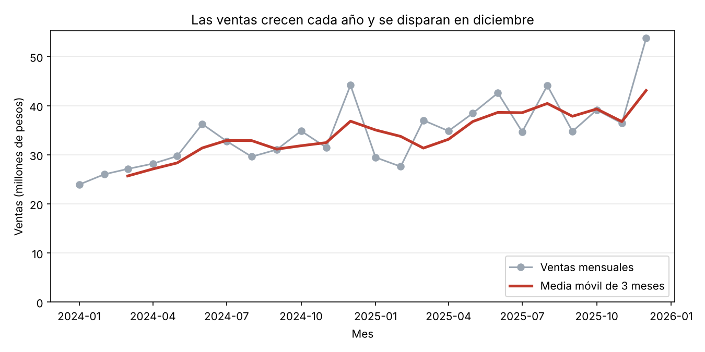
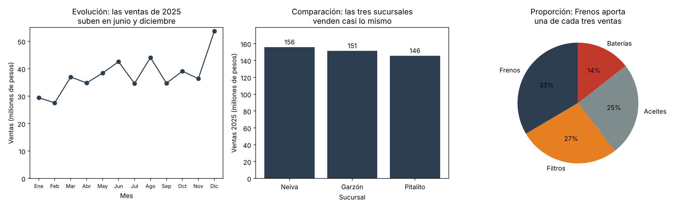
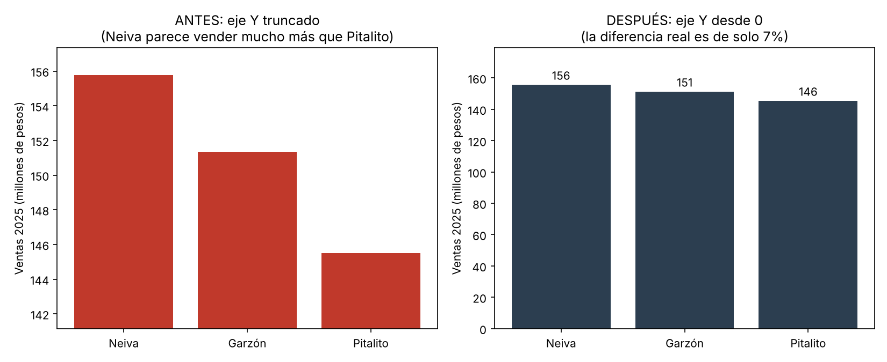
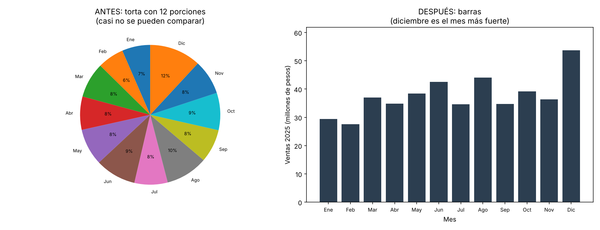

# Parcial práctico Corte 3: Análisis temporal, visualización y optimización

**Curso:** Ciencia de Datos 2026-B
**Estudiante:** Simón Enrique Zapata Claros

## Datos usados

El parcial no trae datos, así que se usaron datos simulados de **Repuestos del Sur**, una tienda de repuestos con tres sucursales (Neiva, Pitalito y Garzón), de enero de 2024 a diciembre de 2025.

- `ventas_detalle.csv`: 6.890 ventas con `id_venta`, `fecha`, `sucursal`, `categoria` y `total` (en pesos).
- `serie_ventas.csv`: ventas totales por día, en miles de pesos (731 días, sin valores nulos).
- `generar_datos.py`: crea los dos archivos.

---

## Problema 1: Serie de tiempo

Código en `problema1.py`:

```python
df = pd.read_csv("serie_ventas.csv", parse_dates=["fecha"])   # la fecha se lee como fecha
df = df.set_index("fecha")                                    # la fecha queda como índice
mensual = df["ventas"].resample("MS").sum()                   # suma por mes
df["movil7"] = df["ventas"].rolling(7).mean()                 # media móvil de 7 días
movil3m = mensual.rolling(3).mean()                           # media móvil de 3 meses
```

**Por qué se hace así:**
- `parse_dates` y `set_index("fecha")` son necesarios para que pandas sepa que los datos son una serie en el tiempo y permita agregar por periodo.
- `resample` suma las ventas de cada mes, y así se ve el comportamiento sin el ruido de cada día.
- La media móvil promedia grupos de datos seguidos y suaviza la serie para ver la dirección general.
- En la versión de pandas usada (3.0.5) el código `"M"` ya no existe, por eso se usa `"MS"` (mes, con la fecha al inicio del mes). El resultado es el mismo que con `resample("M")`.



**Tendencia: sube.** Las ventas de 2024 fueron de 375,1 millones de pesos y las de 2025 de 452,6 millones, un 20,7% más. La media móvil de 3 meses pasa de 25,7 millones (primer dato) a 43,1 millones (último dato).

**Estacionalidad: se repite en los dos años.**

| Mes | 2024 frente al promedio de ese año | 2025 frente al promedio de ese año |
|---|---|---|
| Diciembre | +41,3% | +42,4% |
| Junio | +16,0% | +12,9% |
| Enero | -23,5% | -21,9% |
| Febrero | -16,8% | -26,9% |

Diciembre y junio son los picos, y enero y febrero son los meses bajos. Como el patrón se repite en las mismas épocas cada año, es estacionalidad y no casualidad. También hay un patrón semanal: los domingos se vende menos (835 en promedio, frente a unos 1.150 a 1.225 entre lunes y sábado).

---

## Problema 2: Visualización

Código en `problema2.py`.

### Un gráfico para cada pregunta



| Pregunta | Gráfico | Justificación |
|---|---|---|
| ¿Cómo evolucionan las ventas durante 2025? (evolución) | **Líneas** | Une los puntos en orden y muestra la dirección y los picos en el tiempo |
| ¿Cómo se comparan las sucursales? (comparación) | **Barras** | Comparar la longitud de barras entre categorías es fácil. El eje Y empieza en 0 |
| ¿Qué parte de las ventas aporta cada categoría? (proporción) | **Torta** | Son solo 4 categorías, así que la torta se lee bien. Con más categorías se usarían barras apiladas |

Cada título dice la conclusión: las ventas suben en junio y diciembre, las sucursales venden casi lo mismo, y Frenos aporta una de cada tres ventas (33%).

### Error de diseño 1: eje truncado



- **Error:** el eje Y no empieza en 0, sino cerca de 142. Neiva parece vender mucho más que Pitalito, pero la diferencia real es de solo 7% (156 contra 146 millones).
- **Corrección:** en gráficos de barras el eje Y empieza en 0, y se agregan los valores sobre las barras.

### Error de diseño 2: torta saturada



- **Error:** una torta con 12 porciones es muy difícil de leer, porque las rebanadas se parecen y casi no se pueden comparar.
- **Corrección:** se cambia por barras, que permiten comparar mes a mes y muestran que diciembre es el más fuerte (53,7 millones).

---

## Problema 3: Optimización y métricas

Código en `problema3.py`.

### Consulta lenta y consulta mejorada

**Antes (lenta):**

```sql
SELECT *
FROM ventas
WHERE YEAR(fecha) = 2025;
```

(En SQLite, que es lo que se usó para probar, la función se escribe `strftime('%Y', fecha) = '2025'`.)

**Después (rápida):**

```sql
CREATE INDEX idx_ventas_fecha ON ventas(fecha);

SELECT id_venta, sucursal, total
FROM ventas
WHERE fecha >= '2025-01-01' AND fecha < '2026-01-01';
```

**Por qué mejora:**
1. Se quitó `SELECT *` y se piden solo las columnas necesarias (3 en lugar de 5).
2. Se filtra con un rango de fechas en lugar de aplicar una función sobre la columna. Con la función, la base de datos tiene que calcular el año de cada fila y no puede usar el índice.
3. Se creó un índice sobre `fecha`, que permite ir directo al rango sin leer toda la tabla.

**Comprobación:** las dos consultas devuelven las mismas 3.769 filas y el mismo total vendido (452.654.428 pesos). El plan de la lenta es `SCAN ventas` (lee toda la tabla, aunque el índice exista) y el de la rápida es `SEARCH ... USING INDEX idx_ventas_fecha`. En la prueba, la lenta tardó 2,684 ms y la rápida 1,231 ms, cerca de la mitad del tiempo, con una tabla pequeña; la diferencia crece con tablas más grandes.

### Dos medidas DAX

```dax
Total Ventas = SUM(Ventas[Total])

Ventas 2025 = CALCULATE([Total Ventas], YEAR(Ventas[Fecha]) = 2025)
```

- **Total Ventas:** suma la columna `Total` de la tabla `Ventas`. Cambia según los filtros del tablero (por sucursal, categoría o mes).
- **Ventas 2025:** usa `CALCULATE` para calcular el total pero solo con las ventas de 2025. Sirve para comparar periodos (por ejemplo, 2025 contra otro año) en un tablero.

### Medida y columna calculada

| | Columna calculada | Medida |
|---|---|---|
| Cuándo se calcula | Al cargar los datos, fila por fila | Al vuelo, según los filtros del tablero |
| Ocupa espacio | Sí, queda guardada en la tabla | No |
| Para qué sirve | Clasificar filas (por ejemplo, marcar cada venta como "alta" o "baja") | Agregar: sumas, porcentajes y KPIs |

`Total Ventas` y `Ventas 2025` son medidas porque agregan muchas filas. Clasificar cada venta según su valor sería una columna calculada.

### English requirement

An index works like the index of a book: it lets the database go straight to the rows it needs instead of reading the whole table, so the query runs faster. A measure in Power BI is a calculation written in DAX that is computed on the fly according to the filters of the report, so it does not take up space in the table. Measures are used for totals, percentages and KPIs.

---

## Archivos

| Archivo | Descripción |
|---|---|
| `README.md` | Este documento |
| `generar_datos.py` | Crea los datos simulados |
| `ventas_detalle.csv` | Detalle de ventas |
| `serie_ventas.csv` | Serie diaria de ventas |
| `problema1.py` | Serie de tiempo: `resample`, media móvil, tendencia y estacionalidad |
| `problema2.py` | Gráficos y corrección de errores de diseño |
| `problema3.py` | Consulta lenta y rápida, con comprobación |
| `p1_serie_mensual.png` | Gráfico del problema 1 |
| `p2_tres_preguntas.png` | Los tres gráficos del problema 2 |
| `p2_error_eje.png` | Eje truncado, antes y después |
| `p2_error_torta.png` | Torta saturada, antes y después |
